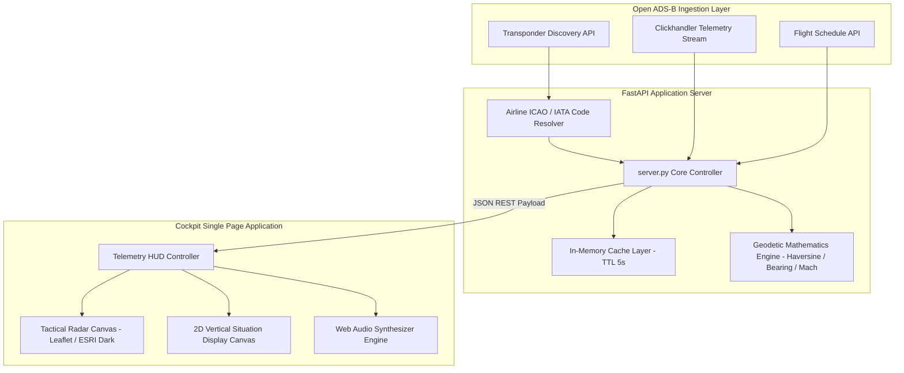

# AeroTrack: Tactical Flight Radar & ADS-B Telemetry System

[](LICENSE)
[](https://www.python.org/)
[](https://fastapi.tiangolo.com/)
[](https://developer.mozilla.org/)
[](https://leafletjs.com/)
[](https://mode-s.org/)
[](#architecture)
[](#)

---

## Language Navigation / Navegação de Idioma

- [English Documentation](#english-documentation)
- [Documentação em Português](#documentação-em-português)

---

<a name="english-documentation"></a>
# English Documentation

## 1. Overview

AeroTrack is a real-time tactical flight radar and aeronautical telemetry system. It processes open-access Automatic Dependent Surveillance-Broadcast (ADS-B) and Mode-S transponder transmissions to provide situational awareness for commercial and general aviation flights globally.

The application features:
- **Tactical Plan Position Indicator (Top-Down Radar):** High-contrast geospatial situational display built on Leaflet with dark cartographic basemaps, aircraft heading vector orientation, transponder track polylines, and automatic geographic reframing.
- **Vertical Situation Display (2D VSD Side-View Profile):** DPI-scaled HTML5 Canvas rendering engine projecting longitudinal cruise altitude, standard Flight Levels (FL), dynamic terrain topography based on airport elevations, climb/descent pitch attitudes, and Top-of-Descent (TOD) flight profile curves.
- **Avionics Telemetry HUD:** Real-time digital gauges for barometric altitude (MSL), ground speed (GS), Mach number, vertical speed indicator (VSI), true heading compass, and Mode-S 24-bit ICAO aircraft addresses.
- **Universal Multi-Flight Ingestion:** Dynamic airline callsign resolution supporting ICAO and IATA format interchanges, search autocomplete, direct URL parameter routing, and non-blocking background polling.

## 2. Architecture



## 3. Mathematical Specifications

### 3.1. Great-Circle Distance (Haversine Formula)
To calculate geodesic distance between coordinates $(\phi_1, \lambda_1)$ and $(\phi_2, \lambda_2)$ with Earth mean radius $R = 6,371.0\text{ km}$:

$$\Delta\phi = \phi_2 - \phi_1, \quad \Delta\lambda = \lambda_2 - \lambda_1$$

$$a = \sin^2\left(\frac{\Delta\phi}{2}\right) + \cos(\phi_1)\cos(\phi_2)\sin^2\left(\frac{\Delta\lambda}{2}\right)$$

$$d = 2 \cdot R \cdot \text{atan2}\left(\sqrt{a}, \sqrt{1 - a}\right)$$

### 3.2. Initial True Bearing
Calculates navigation course heading in degrees:

$$y = \sin(\Delta\lambda) \cdot \cos(\phi_2)$$

$$x = \cos(\phi_1) \cdot \sin(\phi_2) - \sin(\phi_1) \cdot \cos(\phi_2) \cdot \cos(\Delta\lambda)$$

$$\theta = (\text{degrees}(\text{atan2}(y, x)) + 360) \pmod{360}$$

### 3.3. Vertical Speed Indicator (VSI)
Derived from sequential ADS-B telemetry timestamps:

$$\text{VSI} = \frac{\text{Alt}_0 - \text{Alt}_1}{t_0 - t_1} \times 60 \quad (\text{ft/min})$$

### 3.4. 2D Terrain Profile Interpolation
Procedural elevation curve between origin elevation $E_{\text{orig}}$ and destination elevation $E_{\text{dest}}$ along flight distance progress $r = \frac{d}{d_{\text{total}}}$:

$$E_{\text{base}} = E_{\text{orig}} \cdot (1 - r) + E_{\text{dest}} \cdot r$$

$$E_{\text{terrain}} = \max\left(10, \text{round}\left(E_{\text{base}} + \left[260 \cdot \sin(14r) + 130 \cdot \cos(26r)\right] \cdot \sin(\pi r)\right)\right)$$

The term $\sin(\pi r)$ enforces zero topography variance at runway thresholds, matching runway elevations precisely.

## 4. Installation and Setup

### 4.1. Requirements
- Python 3.10 or higher
- Modern web browser (Chrome, Firefox, Safari, Edge)

### 4.2. Setup Instructions

```bash
# Clone the repository
git clone https://github.com/xToshiro/AeroTrack.git
cd AeroTrack

# Install dependencies
pip install -r requirements.txt

# Start the application server
python server.py
```

### 4.3. Windows Quick Start
Execute the provided batch script:
```cmd
run.bat
```

Open the client interface in your browser:
```
http://localhost:8080
```

To load a specific flight directly:
```
http://localhost:8080/?flight=AFR443
http://localhost:8080/?flight=TAM3734
```

## 5. API Reference

### 5.1. Fetch Flight Telemetry
```http
GET /api/flight/{callsign}
```
**Parameters:**
- `callsign` (string, required): Flight number, callsign, or airframe registration.
- `force` (boolean, optional, default: `false`): Bypass cache and force fresh upstream retrieval.

**Response Structure (Excerpt):**
```json
{
  "is_live": true,
  "not_found": false,
  "callsign": "AFR443",
  "flight_number": "AF443",
  "aircraft": {
    "model_name": "Boeing 777-328ER",
    "registration": "F-GSQI",
    "hex": "3949EE"
  },
  "route": {
    "origin": { "iata": "GIG", "city": "Rio De Janeiro", "altitude": 28 },
    "destination": { "iata": "CDG", "city": "Paris", "altitude": 392 },
    "distance_total_km": 9183.1,
    "distance_flown_km": 3410.2,
    "progress_percent": 37.1
  },
  "telemetry": {
    "altitude_ft": 34000,
    "speed_kts": 492,
    "mach": 0.74,
    "heading": 32,
    "vertical_speed_fpm": 0
  }
}
```

### 5.2. Search Flight Directory
```http
GET /api/search?q={query}
```

### 5.3. System Health Check
```http
GET /api/health
```

---

<a name="documentação-em-português"></a>
# Documentação em Português

## 1. Visão Geral

O AeroTrack é um sistema tático de rastreamento de voos e processamento de telemetria aeronáutica em tempo real. A plataforma decodifica dados públicos de transponders ADS-B (Automatic Dependent Surveillance-Broadcast) e sinais Mode-S para prover monitoramento de tráfego aéreo comercial e executivo globalmente.

Principais módulos:
- **Radar Tático Superior (Top-Down Radar):** Display de situação geográfica construído sobre Leaflet com cartografia escura de alto contraste, vetor de orientação angular da aeronave (proa verdadeira), traçado de coordenadas de rastro e re-enquadramento geográfico automático entre rotas.
- **Perfil Vertical de Elevação (2D VSD Side-View):** Motor gráfico em HTML5 Canvas com calibração de DPI projetando o corte longitudinal do voo, níveis padronizados de voo (FL), relevo topográfico dinâmico ajustado às altitudes reais de pista, atitude de arfagem (*pitch*) e curva calculada de início de descida (*Top of Descent - TOD*).
- **HUD de Telemetria de Cockpit:** Instrumentação digital contendo altitude barométrica (MSL), velocidade em solo (GS), número Mach, razão de subida/descida (VSI), rosa dos ventos digital e endereço ICAO Mode-S de 24 bits.
- **Ingestão Universal de Voos:** Resolução dinâmica de identificadores ICAO/IATA, sistema de busca com autocompletar, sincronização bidirecional com parâmetros de URL e ciclo assíncrono de atualização de telemetria.

## 2. Arquitetura do Sistema

O fluxo de dados do backend ao cliente é estruturado em três camadas:
1. **Camada de Ingestão:** Consulta e normaliza dados abertos de transponder e cronogramas.
2. **Servidor Backend (FastAPI):** Implementa cache em memória com TTL de 5 segundos, motor de cálculo geodésico (Haversine, azimute de proa, VSI, Mach) e fallback de contingência em caso de restrição de taxa (HTTP 429).
3. **Cliente Web:** Interface de painel tático de alta performance, sem frameworks pesados, utilizando JavaScript Vanilla, Leaflet e HTML5 Canvas.

## 3. Especificações Matemáticas

### 3.1. Distância Geodésica (Fórmula de Haversine)
Cálculo da distância ortodrômica entre coordenadas $(\phi_1, \lambda_1)$ e $(\phi_2, \lambda_2)$ com raio terrestre médio $R = 6.371,0\text{ km}$:

$$\Delta\phi = \phi_2 - \phi_1, \quad \Delta\lambda = \lambda_2 - \lambda_1$$

$$a = \sin^2\left(\frac{\Delta\phi}{2}\right) + \cos(\phi_1)\cos(\phi_2)\sin^2\left(\frac{\Delta\lambda}{2}\right)$$

$$d = 2 \cdot R \cdot \text{atan2}\left(\sqrt{a}, \sqrt{1 - a}\right)$$

### 3.2. Proa Verdadeira de Navegação
Cálculo do azimute inicial da rota:

$$y = \sin(\Delta\lambda) \cdot \cos(\phi_2)$$

$$x = \cos(\phi_1) \cdot \sin(\phi_2) - \sin(\phi_1) \cdot \cos(\phi_2) \cdot \cos(\Delta\lambda)$$

$$\theta = (\text{degrees}(\text{atan2}(y, x)) + 360) \pmod{360}$$

### 3.3. Razão de Subida e Descida (VSI)
Calculada a partir de pacotes consecutivos de telemetria:

$$\text{VSI} = \frac{\text{Alt}_0 - \text{Alt}_1}{t_0 - t_1} \times 60 \quad (\text{ft/min})$$

## 4. Instalação e Execução

### 4.1. Requisitos
- Python 3.10 ou superior
- Navegador moderno com suporte a HTML5 Canvas e Web Audio API

### 4.2. Instruções de Instalação

```bash
# Clonar o repositório
git clone https://github.com/xToshiro/AeroTrack.git
cd AeroTrack

# Instalar dependências
pip install -r requirements.txt

# Executar a aplicação
python server.py
```

### 4.3. Inicialização Rápida no Windows
Execute o script em lote:
```cmd
run.bat
```

Acesse a aplicação no navegador:
```
http://localhost:8080
```

## 5. Endpoints da API REST

- `GET /api/flight/{callsign}`: Retorna o estado completo de telemetria, rota, aeronave e rastro de navegação do voo especificado.
- `GET /api/search?q={query}`: Busca de voos e companhias aéreas com indicação de voos ativos no ar.
- `GET /api/health`: Verificação de status e contagem de itens em cache.

---

## 6. Project Structure / Estrutura do Projeto

```
AeroTrack/
├── .agents/
│   └── skills/
│       └── flight-tracker/
│           └── SKILL.md              # Antigravity skill specification
├── docs/
│   └── SPECIFICATIONS.md             # Detailed engineering specifications
├── static/
│   ├── css/
│   │   └── style.css                 # Glassmorphic tactical radar stylesheet
│   ├── js/
│   │   └── app.js                    # SPA controller, Leaflet & 2D VSD engine
│   └── index.html                    # Main tactical cockpit view
├── .gitignore                        # Git exclusion rules
├── LICENSE                           # GNU General Public License v3.0
├── README.md                         # Bilingual project documentation
├── requirements.txt                  # Python dependencies
├── run.bat                           # Windows batch execution script
└── server.py                         # FastAPI backend & telemetry pipeline
```

---

## 7. License / Licença

This project is licensed under the **GNU General Public License v3.0** - see the [LICENSE](LICENSE) file for complete details.

Este projeto é distribuído sob os termos da licença **GNU General Public License v3.0** - consulte o arquivo [LICENSE](LICENSE) para detalhes completos.
