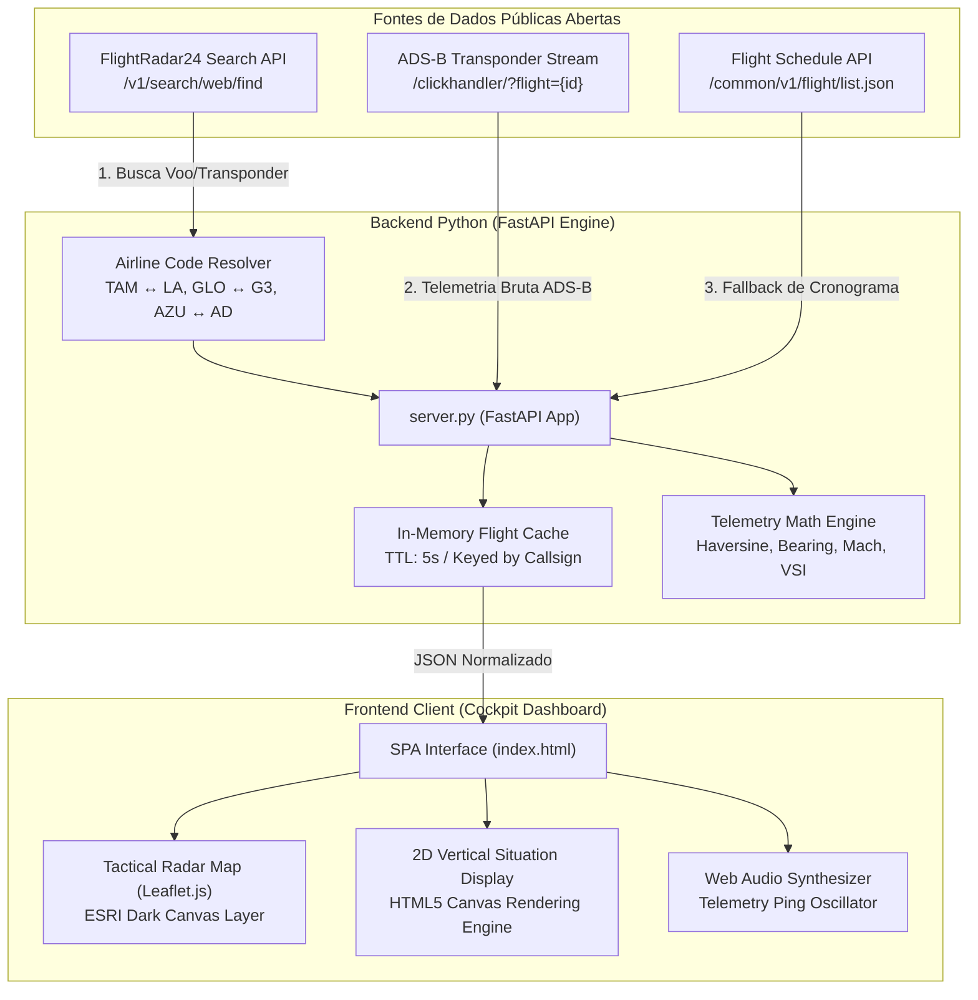

# AeroTrack: Especificação Técnica de Engenharia (Technical Specifications)

**Documento:** AeroTrack ADS-B System Architecture & Technical Specifications  
**Versão:** 2.0.0  
**Data:** Outubro de 2026  
**Status:** Produção / Estável  

---

## 1. Visão Geral do Sistema

O **AeroTrack** é um sistema de alta precisão para monitoramento de tráfego aéreo comercial e executivo global em tempo real. O sistema captura pacotes abertos de transponder **ADS-B (Automatic Dependent Surveillance-Broadcast)** e telemetria Mode-S, normaliza dados de múltiplas companhias aéreas e apresenta um console tático de comando integrado por:

1. **Radar Tático Superior (Top-down 2D Map):** Motor Leaflet customizado com cartografia militar/ATC escura (ESRI World Dark Gray), rastro de navegação vetorial e centralização dinâmica.
2. **Perfil Vertical de Elevação // Visão Lateral (2D VSD - Vertical Situation Display):** Motor gráfico customizado em HTML5 Canvas de alta resolução (DPI-aware) que projeta o perfil longitudinal de subida, cruzeiro e descida em relação ao relevo do terreno e aos níveis de voo padronizados (Flight Levels - FL).
3. **Cockpit Telemetry HUD Ribbon:** Indicadores digitais em tempo real de altitude barométrica (FT/M), velocidade em solo (GS em KTS e KM/H), número Mach estimado, razão de subida/descida (VSI em FPM), proa magnética e coordenadas geográficas WGS-84.
4. **Alerta Sonoro Tático:** Sintetizador de áudio vetorial via Web Audio API para feedback auditivo de captura de pacote ADS-B sem dependência de arquivos externos de áudio.

---

## 2. Diagrama de Arquitetura



---

## 3. Especificação do Backend (Python / FastAPI)

### 3.1. Requisitos de Ambiente
- **Python:** 3.10+ (compatível até Python 3.14)
- **Dependências:** `fastapi`, `uvicorn`, `requests`
- **Porta Padrão:** `8080` (configurável via linha de comando ou script batch)

### 3.2. Endpoints da API REST

#### `GET /api/flight/{callsign}`
Obtém o estado completo e atualizado de telemetria de qualquer voo ativo ou programado.
- **Parâmetros de Rota:**
  - `callsign` (string, obrigatório): Código ICAO/IATA do voo (ex: `TAM3734`, `AFR443`, `GLO1500`, `AZU4000`, `TAP089`).
- **Parâmetros de Query:**
  - `force` (bool, opcional, default: `false`): Ignora o cache em memória e força requisição direta às redes públicas.
- **Respostas:**
  - `200 OK`: Payload JSON estruturado conforme o esquema da seção 4.

#### `GET /api/search?q={query}`
Realiza busca instantânea de voos, companhias aéreas e prefixos ativos.
- **Parâmetros de Query:**
  - `q` (string, obrigatório, min_length: 2): Termo de busca.
- **Resposta:**
  - `200 OK`: Lista de correspondências com identificador de status ao vivo (`live`, `schedule`, `aircraft`).

#### `GET /api/health`
Verificação de integridade operacional do serviço e monitoramento do cache ativo.

---

## 4. Estrutura do Modelo de Dados (JSON Schema)

O payload retornado por `/api/flight/{callsign}` segue estritamente o formato:

```json
{
  "is_live": true,
  "not_found": false,
  "flight_id": "37f4a21e",
  "callsign": "TAM3734",
  "flight_number": "LA3734",
  "alternative_flight": "JJ3734",
  "status": {
    "text": "Em Voo",
    "color": "green",
    "live": true,
    "phase": "CRUISE",
    "description": "Aeronave em voo transmitindo ADS-B em tempo real"
  },
  "aircraft": {
    "model_code": "A20N",
    "model_name": "Airbus A320-271N",
    "registration": "PR-XBV",
    "hex": "E4A125",
    "photo_url": "https://cdn.jetphotos.com/...",
    "photo_copyright": "JetPhotos / Leonardo M."
  },
  "airline": {
    "name": "LATAM Airlines Brasil",
    "iata": "LA",
    "icao": "TAM",
    "logo": "https://cdn.flightradar24.com/..."
  },
  "route": {
    "origin": {
      "name": "Brasília Presidente Juscelino Kubitschek Int'l",
      "city": "Brasília",
      "iata": "BSB",
      "icao": "SBBR",
      "terminal": "1",
      "gate": "38",
      "position": { "lat": -15.8711, "lng": -47.9186, "altitude": 3479 },
      "timezone": "America/Sao_Paulo"
    },
    "destination": {
      "name": "Fortaleza Pinto Martins Int'l",
      "city": "Fortaleza",
      "iata": "FOR",
      "icao": "SBFZ",
      "terminal": "1",
      "gate": "4",
      "position": { "lat": -3.7763, "lng": -38.5325, "altitude": 82 },
      "timezone": "America/Fortaleza"
    },
    "distance_total_km": 1690.4,
    "distance_flown_km": 680.2,
    "distance_remaining_km": 1010.2,
    "progress_percent": 40.2
  },
  "telemetry": {
    "latitude": -11.9542,
    "longitude": -44.2018,
    "altitude_ft": 36000,
    "altitude_m": 10973,
    "speed_kts": 455,
    "speed_kmh": 843,
    "mach": 0.69,
    "heading": 38,
    "vertical_speed_fpm": 0,
    "timestamp": 1729388400,
    "trail_points_count": 84
  },
  "times": {
    "scheduled_departure": 1729384800,
    "real_departure": 1729385100,
    "estimated_arrival": 1729393800,
    "scheduled_arrival": 1729394400
  },
  "trail": [
    { "lat": -15.87, "lng": -47.91, "alt": 3479, "spd": 0, "ts": 1729384800, "dist_km": 0.0 }
  ],
  "last_updated": 1729388410,
  "source": "ADS-B Transponder via FlightRadar24 Public Network"
}
```

---

## 5. Fundamentação Matemática & Algoritmos de Telemetria

### 5.1. Distância Ortodrômica (Haversine Formula)
Para calcular a distância geodésica em quilômetros considerando o raio médio da Terra ($R = 6.371,0\text{ km}$):

$$\Delta\phi = \text{radians}(\phi_2 - \phi_1), \quad \Delta\lambda = \text{radians}(\lambda_2 - \lambda_1)$$

$$a = \sin^2\left(\frac{\Delta\phi}{2}\right) + \cos(\text{radians}(\phi_1)) \cdot \cos(\text{radians}(\phi_2)) \cdot \sin^2\left(\frac{\Delta\lambda}{2}\right)$$

$$d = 2 \cdot R \cdot \text{atan2}\left(\sqrt{a}, \sqrt{1 - a}\right)$$

### 5.2. Cálculo de Proa Inicial (True Navigation Bearing)
Calcula o azimute em graus entre dois pontos de coordenadas no elipsoide:

$$y = \sin(\Delta\lambda) \cdot \cos(\text{radians}(\phi_2))$$

$$x = \cos(\text{radians}(\phi_1)) \cdot \sin(\text{radians}(\phi_2)) - \sin(\text{radians}(\phi_1)) \cdot \cos(\text{radians}(\phi_2)) \cdot \cos(\Delta\lambda)$$

$$\theta_{\text{deg}} = (\text{degrees}(\text{atan2}(y, x)) + 360) \pmod{360}$$

### 5.3. VSI (Vertical Speed Indicator)
Diferencial finito sobre os dois últimos pacotes cronológicos de transponder gravados no rastro ADS-B:

$$\text{VSI} = \frac{\text{Alt}_0 - \text{Alt}_1}{t_0 - t_1} \times 60 \quad (\text{ft/min})$$

### 5.4. Número Mach
Estimativa direta com base na velocidade do som na atmosfera padrão ao nível do mar ($a_0 \approx 661,47\text{ kts}$):

$$\text{Mach} = \frac{V_{\text{kts}}}{661,47}$$

---

## 6. Motor Gráfico do Perfil Vertical (2D VSD Engine)

O componente 2D VSD (`static/js/app.js` -> `drawElevationProfile`) projeta uma visão lateral do voo ao longo do eixo da rota ($0\text{ km} \rightarrow \text{TotalDist}$).

### 6.1. Transformação de Coordenadas de Tela
Com base no espaço do canvas e na densidade de pixels do dispositivo (`window.devicePixelRatio`):

$$X(\text{dist}) = \text{padLeft} + \min\left(\text{plotW}, \max\left(0, \frac{\text{dist}}{\text{totalDist}} \cdot \text{plotW}\right)\right)$$

$$Y(\text{alt}) = \text{padTop} + \text{plotH} - \min\left(\text{plotH}, \max\left(0, \frac{\text{alt}}{\text{altMax}} \cdot \text{plotH}\right)\right)$$

Onde:
- $\text{altMax} = 42.000\text{ FT}$ ($\text{FL420}$, teto operacional da aviação comercial).
- $\text{padLeft} = 90\text{ px}$ (margem de segurança para evitar cortes de legendas como `FL300 (30k)`).

### 6.2. Interpolação Procedural de Terreno & Amortecimento
Para qualquer voo entre dois aeroportos com elevações de pista $\text{Elev}_{\text{orig}}$ e $\text{Elev}_{\text{dest}}$:

$$\text{ratio} = \frac{\text{dist}}{\text{totalDist}}$$

$$\text{BaseElev} = \text{Elev}_{\text{orig}} \cdot (1 - \text{ratio}) + \text{Elev}_{\text{dest}} \cdot \text{ratio}$$

$$\text{Damping} = \sin(\pi \cdot \text{ratio})$$

$$\text{HillVariation} = \left(260 \cdot \sin(14 \cdot \text{ratio}) + 130 \cdot \cos(26 \cdot \text{ratio})\right) \cdot \text{Damping}$$

$$\text{TerrainElev} = \max\left(10, \text{round}(\text{BaseElev} + \text{HillVariation})\right)$$

A função $\sin(\pi \cdot \text{ratio})$ zera o amortecimento exatamente nas pistas de decolagem e pouso ($\text{ratio} = 0$ e $\text{ratio} = 1$), garantindo que a elevação do terreno desenhada coincida com a cota altimétrica exata de cada aeroporto.

### 6.3. Clamping de Altitude no Solo (Prevenção de Queda Falsa a 0 FT)
Muitos transponders comerciais transmitem $0\text{ ft}$ de altitude radar (AGL) durante o taxiamento no pátio de aeroportos altos (como BSB a 3.479 ft MSL). O motor do AeroTrack aplica clamping:
- Se $\text{dist} < 35\text{ km}$ e $\text{alt} < \text{OrigElev}$, o valor é forçado para $\text{OrigElev}$.
- O rastro preenchido conecta-se estritamente à linha do relevo do terreno, eliminando fendas escuras até o nível do mar.

### 6.4. Cálculo da Curva de Descida e Ponto de Top of Descent (TOD)
A rampa de descida ideal é projetada usando uma curva de Bézier cúbica a partir do ponto de TOD:

$$\text{DescentDistKm} = \min\left(260, \frac{\text{Alt}_{\text{cruise}}}{1000} \times 5,8\right)$$

$$\text{TOD}_{\text{km}} = \max\left(\text{Dist}_{\text{flown}}, \text{Dist}_{\text{total}} - \text{DescentDistKm}\right)$$

---

## 7. Frontend & Experiência de Usuário (UX)

### 7.1. Gerenciamento de Estado Universal
- **Sincronização de URL:** Ao pesquisar ou clicar em qualquer chip de voo, a aplicação atualiza os parâmetros de consulta (`?flight=CODIGO`) via `history.replaceState` sem recarregar a página.
- **Auto-Framing Geográfico:** Quando um novo voo é selecionado (ex: transição de rota nacional BSB-FOR para internacional GIG-CDG), a flag `state.initialFramed = false` dispara automaticamente `map.fitBounds` com padding para re-enquadrar toda a rota global.
- **Banner de Status & Voo Offline:** Se o transponder estiver desligado ou o voo não estiver transmitindo sinal ao vivo, o sistema exibe um banner de alerta tático contendo atalhos diretos para voos populares em rota.

### 7.2. Cartografia Militar Dark
A cartografia principal utiliza os serviços ArcGIS World Dark Gray Base & Reference:
- Resolução nítida de pistas, continentes e fronteiras.
- Zero dependência de chaves de API restritivas.
- Alternância rápida para OpenStreetMap padrão caso o operador prefira visão clássica.

---

## 8. Segurança, Robustez e Tolerância a Falhas

1. **Proteção contra HTTP 429 (Rate Limiting):**
   - O backend implementa um cache em memória com TTL de 5 segundos por chamada de voo.
   - Em caso de resposta 429 nas requisições detalhadas do clickhandler, o servidor degrada graciosamente e extrai as coordenadas geográficas diretamente da resposta leve do endpoint de busca, mantendo a continuidade do radar.
2. **Sem Credenciais Sensíveis:**
   - Todo o tráfego utiliza fontes de telemetria pública aberta, dispensando armazenamento de segredos ou tokens de autenticação em disco.
3. **Gerenciamento de Processos em Segundo Plano:**
   - Em conformidade com os princípios operacionais, o servidor pode ser iniciado e finalizado via `run.bat` ou comando manual sem processos órfãos em background.
